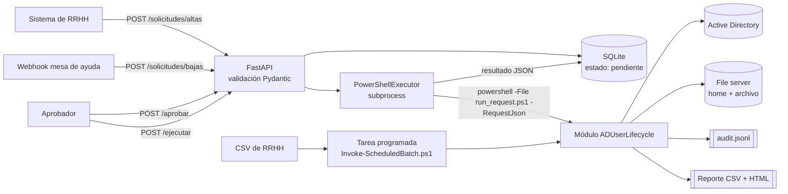
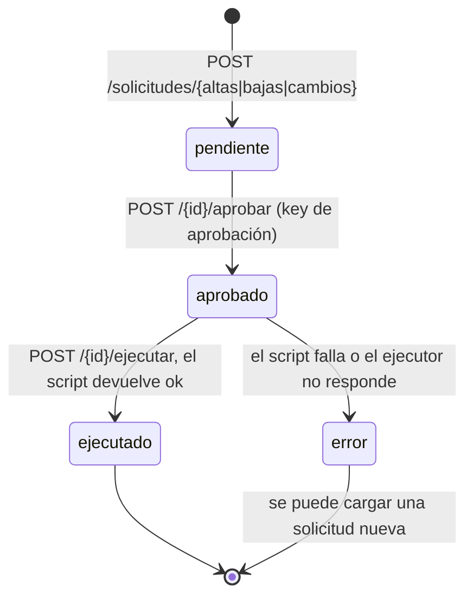

# ad-user-lifecycle

Automatización de **altas, bajas y modificaciones (ABM) de usuarios en Active Directory**, pensada para el trabajo diario de un equipo de soporte L2: lo que normalmente se hace a mano con la consola de *Usuarios y equipos de AD* siguiendo un checklist, convertido en un proceso repetible, auditable y con simulación previa (`-WhatIf`).

El proyecto tiene dos partes:

| Parte | Tecnología | Qué hace |
|---|---|---|
| `src/ADUserLifecycle` | PowerShell 5.1 (compatible con 7) | Módulo con las operaciones sobre AD, file server y auditoría |
| `api/` | Python 3.11+, FastAPI, SQLAlchemy, SQLite | Recibe solicitudes de RRHH o de mesa de ayuda, exige aprobación y ejecuta el módulo |

Todo se prueba sin un dominio real: los cmdlets de ActiveDirectory se reemplazan por stubs y mocks en Pester, y la API usa un ejecutor falso en pytest.

## Funcionalidades

**Alta** (`New-LifecycleUser`)
- Genera el `sAMAccountName` con la convención inicial + primer apellido (`jperez`), sin tildes ni ñ, uniendo partículas (`de la Fuente` → `mdelafuente`) y resolviendo colisiones (`jperez2`, `jperez3`...) sin pasar los 20 caracteres.
- Verifica que no exista otra cuenta con el mismo legajo (`EmployeeID`), así reprocesar un lote no duplica cuentas.
- Contraseña temporal aleatoria con RNG criptográfico, que cumple la política (mayúscula, minúscula, número y símbolo, sin caracteres ambiguos y sin contener el usuario) y obliga a cambiarla al iniciar sesión.
- Ubica la cuenta en la OU del área y la agrega a los grupos que corresponden según el mapeo de roles.
- Crea la carpeta personal en el file server, corta la herencia y aplica la ACL con `Get-Acl`/`Set-Acl` usando el SID de la cuenta nueva.

**Cambio de área o puesto** (`Set-LifecycleUserTransfer`)
- Recalcula los grupos del rol: quita los del rol anterior y agrega los del nuevo. Los grupos asignados a mano no se tocan.
- Mueve la cuenta a la OU de la nueva área.

**Baja** (`Disable-LifecycleUser`)
1. Guarda un snapshot JSON con todas las membresías (para poder revertir una baja hecha por error).
2. Deshabilita la cuenta y le asigna una contraseña aleatoria.
3. Quita todos los grupos salvo *Domain Users*.
4. Escribe en la descripción `Baja yyyy-MM-dd | Ticket X | operador`.
5. Si tiene buzón, la oculta de la libreta global (`msExchHideFromAddressLists`).
6. Comprime la carpeta personal en el share de archivo.
7. Mueve la cuenta a la OU `Bajas`.

**Depuración** (`Remove-ExpiredDisabledUsers`): elimina las cuentas de `Bajas` con más de N días de baja. Omite cuentas privilegiadas (`adminCount = 1`) y cuentas sin fecha de baja reconocible.

**Lote** (`Invoke-LifecycleBatch`): procesa un CSV de altas, bajas y cambios con un `try/catch` por fila y genera un reporte CSV y HTML.

Todas las funciones soportan `-WhatIf` y `-Confirm`, y escriben un log de auditoría en formato JSON lines (quién, qué, cuándo, ticket y resultado).

## Flujo



Estados de una solicitud en la API:



## Estructura

```
ad-user-lifecycle/
├── api/                        # Servicio FastAPI
│   ├── main.py                 # create_app() y endpoints
│   ├── db.py                   # Modelo SQLAlchemy y estados
│   ├── schemas.py              # Validación Pydantic
│   ├── executor.py             # PowerShellExecutor (pluggable)
│   ├── security.py             # API keys con dos roles
│   ├── settings.py             # Configuración por variables de entorno
│   └── tests/                  # pytest con TestClient y SQLite en memoria
├── config/
│   └── lifecycle.config.json   # OUs, grupos por rol, shares, retención
├── docs/
│   └── ejemplo-audit.jsonl     # Ejemplo de log de auditoría
├── scripts/
│   ├── run_request.ps1         # Punto de entrada para la API
│   ├── Invoke-ScheduledBatch.ps1
│   ├── Register-ScheduledBatch.ps1
│   └── ejemplo_lote.csv
├── src/ADUserLifecycle/
│   ├── ADUserLifecycle.psd1
│   ├── ADUserLifecycle.psm1
│   ├── Public/                 # Funciones exportadas
│   └── Private/                # Nombres, contraseñas, grupos, ACL, auditoría
└── tests/                      # Pester 5 (AD mockeado)
```

## Requisitos

- Windows PowerShell 5.1 o PowerShell 7 en el equipo que ejecuta la automatización.
- Módulo `ActiveDirectory` (RSAT: `Install-WindowsFeature RSAT-AD-PowerShell` en servidores o `Add-WindowsCapability -Online -Name Rsat.ActiveDirectory.DS-LDS.Tools~~~~0.0.1.0` en clientes). No hace falta para correr los tests.
- Python 3.11 o superior para la API.
- Pester 5.5 o superior para los tests de PowerShell.

## Configuración

El archivo `config/lifecycle.config.json` concentra todo lo que depende de la organización. Se carga con `Import-LifecycleConfig` (o se toma automáticamente de `$env:ADLC_CONFIG` o de la ruta por defecto). Las rutas relativas se resuelven contra la carpeta donde está el JSON.

| Sección | Clave | Descripción |
|---|---|---|
| `Domain` | `NetBIOS`, `UpnSuffix` | Dominio y sufijo de UPN (`jperez@contoso.local`) |
| | `Server` | Opcional. DC fijo para todas las operaciones; evita errores por replicación entre pasos |
| `OUs` | `Areas` | Área → OU destino. Un área que no está acá corta el alta antes de crear nada |
| | `Bajas` | OU donde quedan las cuentas dadas de baja |
| `RoleGroups` | `Common` | Grupos para todos los empleados |
| | `Areas` | Área → grupos |
| | `Puestos` | Puesto → grupos. Grupos efectivos = Common + Área + Puesto, sin duplicados |
| `Password` | `Length` | Largo de la contraseña temporal (mínimo 14) |
| `HomeFolders` | `Root` | Share de carpetas personales (`\\fs01\home$`) |
| | `ArchiveRoot` | Share donde se guardan los zip de las bajas |
| | `Drive`, `Rights` | Letra de unidad (`H:`) y permiso del usuario (`Modify`) |
| `Offboarding` | `KeepGroups` | Grupos que no se quitan en la baja (*Domain Users* / *Usuarios del dominio*) |
| | `SnapshotFolder` | Carpeta de los snapshots de membresías |
| | `RetentionDays` | Días de baja antes de eliminar la cuenta |
| | `RemoveHomeAfterArchive` | Borra la carpeta original luego de comprimirla (por defecto `false`) |
| `Audit` | `LogPath` | Archivo JSON lines de auditoría |
| `Batch` | `ReportFolder` | Carpeta de reportes de lotes |

Ejemplo de mapeo de roles:

```json
"RoleGroups": {
  "Common": ["GG_Todos_Empleados", "GG_Intranet_Lectura"],
  "Areas":   { "Sistemas": ["GG_Sistemas", "GG_FS_Sistemas_RW"] },
  "Puestos": { "Analista de Soporte": ["GG_Helpdesk", "GG_VPN"] }
}
```

## Uso del módulo

```powershell
Import-Module .\src\ADUserLifecycle\ADUserLifecycle.psd1
Import-LifecycleConfig -Path .\config\lifecycle.config.json

# Simular primero, siempre
New-LifecycleUser -Nombre 'Juan' -Apellido 'Pérez' -Legajo 10234 -Area Sistemas `
    -Puesto 'Analista de Soporte' -Manager mgarcia -FechaIngreso 2026-11-02 -Ticket RRHH-1001 -WhatIf

Set-LifecycleUserTransfer -Identity lgomez -NuevaArea Finanzas -NuevoPuesto 'Analista Contable' -Ticket RRHH-1004
Disable-LifecycleUser -Identity acastro -Ticket INC-2045
Remove-ExpiredDisabledUsers -Days 90 -WhatIf
```

### Lote CSV

Columnas: `accion` (`alta`, `baja`, `cambio`), `nombre`, `apellido`, `legajo`, `area`, `puesto`, `manager`, `fecha_ingreso`, `usuario`, `ticket`. Se acepta separador `,` o `;` (Excel en español) y fechas `yyyy-MM-dd` o `dd/MM/yyyy`. Ver `scripts/ejemplo_lote.csv`.

```powershell
# Validar el archivo de RRHH sin tocar AD: genera el reporte con estado "Simulado"
Invoke-LifecycleBatch -Path .\scripts\ejemplo_lote.csv -WhatIf

# Ejecutar y guardar las contraseñas temporales cifradas con DPAPI
Invoke-LifecycleBatch -Path .\altas.csv -CredentialExportPath D:\ABM\privado\credenciales.csv
```

Un error en una fila (área inexistente, legajo duplicado, usuario que no existe) queda en el reporte con el motivo y el lote sigue. El reporte HTML colorea cada fila según el estado (`OK`, `Advertencia`, `Error`, `Simulado`).

### Tarea programada

```powershell
.\scripts\Register-ScheduledBatch.ps1 -InboxFolder D:\ABM\entrada `
    -ServiceAccount 'CONTOSO\gmsa-abm$' -At '06:30' -PurgeExpired -WhatIf
```

La tarea procesa cada CSV de la carpeta de entrada y lo mueve a `procesados` o a `con_errores`. Está pensada para correr con una **gMSA**, así no queda ninguna contraseña guardada.

## API

```bash
python -m venv .venv
.venv\Scripts\activate            # Linux/macOS: source .venv/bin/activate
pip install -r requirements.txt

set ADLC_INTAKE_API_KEY=...       # key para RRHH / webhook (solo carga y consulta)
set ADLC_APPROVER_API_KEY=...     # key para aprobadores (aprobar y ejecutar)
uvicorn --factory api.main:create_app --port 8000
```

| Variable | Por defecto | Descripción |
|---|---|---|
| `ADLC_INTAKE_API_KEY` | obligatoria | Key de carga |
| `ADLC_APPROVER_API_KEY` | obligatoria | Key de aprobación (tiene que ser distinta) |
| `ADLC_DATABASE_URL` | `sqlite:///./adlc.db` | Cadena de SQLAlchemy |
| `ADLC_POWERSHELL` | `powershell` | Ejecutable (`pwsh` para PowerShell 7) |
| `ADLC_CONFIG` | config del repo | JSON de configuración del módulo |
| `ADLC_TIMEOUT_SECONDS` | `300` | Tiempo máximo por ejecución |
| `ADLC_DRY_RUN` | `false` | Ejecuta el módulo con `-WhatIf` |

| Método | Ruta | Rol |
|---|---|---|
| `POST` | `/solicitudes/altas` | carga |
| `POST` | `/solicitudes/bajas` | carga |
| `POST` | `/solicitudes/cambios` | carga |
| `GET` | `/solicitudes?estado=pendiente` | carga |
| `GET` | `/solicitudes/{id}` | carga |
| `POST` | `/solicitudes/{id}/aprobar` | aprobación |
| `POST` | `/solicitudes/{id}/ejecutar` | aprobación |
| `GET` | `/health` | sin autenticación |

```bash
curl -X POST http://localhost:8000/solicitudes/altas \
  -H "X-API-Key: $ADLC_INTAKE_API_KEY" -H "Content-Type: application/json" \
  -d '{"nombre":"Juan","apellido":"Pérez","legajo":"10234","area":"Sistemas",
       "puesto":"Analista de Soporte","manager":"mgarcia","fecha_ingreso":"2026-11-02",
       "ticket":"RRHH-1001","origen":"rrhh"}'

curl -X POST http://localhost:8000/solicitudes/1/aprobar \
  -H "X-API-Key: $ADLC_APPROVER_API_KEY" -H "Content-Type: application/json" -d '{"aprobador":"mgarcia"}'

curl -X POST http://localhost:8000/solicitudes/1/ejecutar -H "X-API-Key: $ADLC_APPROVER_API_KEY"
```

La documentación interactiva queda en `http://localhost:8000/docs`.

El ejecutor se inyecta en `create_app(settings, executor)`: cualquier objeto con un método `execute(request) -> ExecutionResult` sirve. Los tests usan un `FakeExecutor` que registra las llamadas sin ejecutar nada.

## Tests

### Pester (PowerShell)

Los tests definen stubs de los cmdlets de AD en `tests/TestHelper.ps1` y los mockean con Pester, así corren en cualquier Windows sin RSAT y sin riesgo de tocar un dominio. Cubren generación de usuario y colisiones, política de contraseñas, mapeo de grupos, alta con advertencias, snapshot de membresías en la baja, depuración por antigüedad, manejo de errores del lote y que `-WhatIf` no llame a ningún cmdlet que modifique AD.

```powershell
Install-Module Pester -MinimumVersion 5.5 -Scope CurrentUser -Force -SkipPublisherCheck
.\tests\Invoke-Tests.ps1          # salida detallada
.\tests\Invoke-Tests.ps1 -CI      # código de salida != 0 si falla algo + testResults.xml
```

Análisis estático:

```powershell
Install-Module PSScriptAnalyzer -Scope CurrentUser -Force
Invoke-ScriptAnalyzer -Path .\src -Recurse -Severity Warning
Invoke-ScriptAnalyzer -Path .\scripts -Recurse -Severity Warning
```

### pytest (API)

```bash
pip install -r requirements-dev.txt
pytest
ruff check .
ruff format --check .
```

### CI

`.github/workflows/ci.yml` corre ruff y pytest (Python 3.11, 3.12 y 3.13 en Ubuntu) y, en `windows-latest` con Windows PowerShell 5.1, PSScriptAnalyzer (severidad Error) y la suite de Pester.

## Permisos en AD (mínimo privilegio)

La cuenta que ejecuta la automatización **no debe ser Domain Admin**. Se recomienda una gMSA (`CONTOSO\gmsa-abm$`) con permisos delegados con el asistente *Delegar control* de *Usuarios y equipos de AD* o con `dsacls`:

| Dónde | Permiso | Para qué |
|---|---|---|
| OUs de áreas (`OU=Usuarios`) | Crear y eliminar objetos Usuario | Altas |
| OUs de áreas | Restablecer contraseña, leer/escribir `pwdLastSet`, `userAccountControl` | Contraseña temporal, deshabilitar |
| OUs de áreas | Escribir `description`, `department`, `title`, `manager`, `employeeID`, `homeDirectory`, `homeDrive`, `displayName` | Atributos del alta y cambios |
| OUs de áreas y `OU=Bajas` | Mover objetos (crear hijos en destino y eliminar en origen) | Cambios de área y bajas |
| `OU=Bajas` | Eliminar objetos Usuario y subárbol | `Remove-ExpiredDisabledUsers` |
| OU de grupos administrados | Escribir `member` solo en los grupos del mapeo de roles | Altas, cambios y bajas |
| Usuarios con buzón | Escribir `msExchHideFromAddressLists` | Ocultar de la GAL |
| File server | Control total sobre `home$` y modificar en `archivo$` | Carpetas personales y archivo |

Ejemplo con `dsacls` (restablecer contraseña sobre usuarios de una OU):

```
dsacls "OU=Usuarios,OU=Empresa,DC=contoso,DC=local" /I:S /G "CONTOSO\gmsa-abm$:CA;Reset Password;user"
dsacls "OU=Usuarios,OU=Empresa,DC=contoso,DC=local" /I:S /G "CONTOSO\gmsa-abm$:WP;pwdLastSet;user"
```

Buenas prácticas aplicadas:
- Los grupos privilegiados (Domain Admins, Account Operators, etc.) están protegidos por AdminSDHolder; la delegación anterior no alcanza para modificarlos, y es intencional.
- La depuración omite cuentas con `adminCount = 1`.
- La API separa la key de carga de la de aprobación: el sistema de RRHH puede pedir un alta, pero no ejecutarla.
- La contraseña temporal nunca se guarda en el log, en la base de la API ni en la salida de `run_request.ps1`. En el modo lote se puede exportar cifrada con DPAPI.

## Log de auditoría

Cada operación agrega una línea JSON a `logs/audit.jsonl` (UTF-8 sin BOM). Se puede consultar con PowerShell o ingerir en un SIEM:

```json
{"timestamp":"2026-10-28T09:02:11.417Z","operator":"CONTOSO\\gmsa-abm$","host":"SRV-AUTOM01","action":"alta","target":"jperez","ticket":"RRHH-1001","result":"ok","details":{"legajo":"10234","ou":"OU=Sistemas,OU=Usuarios,OU=Empresa,DC=contoso,DC=local","groups":["GG_Todos_Empleados","GG_Sistemas","GG_Helpdesk","GG_VPN"],"homeDirectory":"\\\\fs01.contoso.local\\home$\\jperez","warnings":[]},"context":{"request_id":"12","requested_by":"rrhh","approved_by":"mgarcia","source":"api"}}
{"timestamp":"2026-10-28T09:06:02.554Z","operator":"CONTOSO\\gmsa-abm$","host":"SRV-AUTOM01","action":"baja","target":"acastro","ticket":"INC-2045","result":"ok","details":{"groupsRemoved":["GG_Comercial","GG_VPN"],"snapshot":"D:\\ABM\\logs\\bajas\\acastro_20261028-090602.json","archive":"\\\\fs01.contoso.local\\archivo$\\bajas\\acastro_20261028-090602.zip","hiddenFromGal":true,"warnings":[]},"context":{"source":"tarea-programada"}}
```

```powershell
# ¿Qué se hizo con el ticket INC-2045?
Get-Content .\logs\audit.jsonl | ConvertFrom-Json | Where-Object ticket -eq 'INC-2045'

# Errores del último día
Get-Content .\logs\audit.jsonl | ConvertFrom-Json |
    Where-Object { $_.result -eq 'error' -and [datetime]$_.timestamp -gt (Get-Date).AddDays(-1) }
```

Hay un ejemplo más completo en `docs/ejemplo-audit.jsonl`. El campo `result` puede ser `ok`, `advertencia`, `error` o `simulado` (ejecuciones con `-WhatIf`).

## Decisiones de diseño

- **Configuración en JSON**: Windows PowerShell 5.1 no trae parser de YAML y no se quiere depender de módulos externos en el servidor.
- **Una sola confirmación por operación**: cada función llama a `ShouldProcess` una vez con el plan completo (OU, grupos, carpeta). Con `-WhatIf` se ve exactamente lo que se va a hacer.
- **Errores parciales como advertencias**: si falla un grupo o la carpeta personal, la cuenta igual se crea y el resultado queda en `Advertencia` con el detalle, para que mesa de ayuda lo complete. Los errores que impiden la operación (área inválida, legajo duplicado) cortan antes de modificar nada.
- **SID en lugar de nombre en la ACL**: evita fallas cuando el file server consulta un DC al que la cuenta nueva todavía no replicó.
- **Fecha de baja en la descripción**: `whenChanged` cambia con cualquier modificación, así que no sirve para calcular antigüedad.
- **Archivos PowerShell en UTF-8 con BOM**: Windows PowerShell 5.1 interpreta los archivos sin BOM como ANSI y rompe los acentos.

## Limitaciones conocidas

- `Compress-Archive` en Windows PowerShell 5.1 no soporta archivos de más de 2 GB ni rutas largas; para carpetas personales grandes conviene reemplazarlo por `robocopy` a un share de archivo o por 7-Zip.
- La ejecución de una solicitud en la API es sincrónica: la llamada a `/ejecutar` espera a que termine el script. Para volumen alto convendría una cola de trabajos.
- El ocultamiento de la GAL escribe el atributo en AD; en entornos Exchange Online híbridos el cambio llega en el siguiente ciclo de sincronización.
- No hay reversión automática de una baja: el snapshot JSON tiene la información para hacerlo, pero se restaura a mano.
